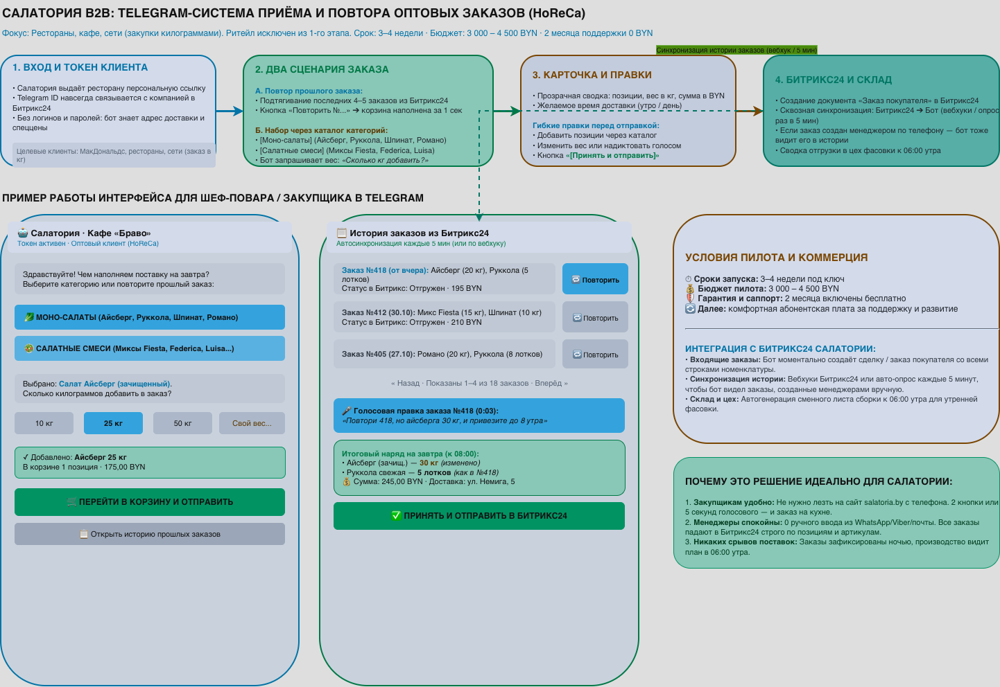

# ООО «Салатория» (`salatoria.by`) — Telegram-система приёма и автоповтора B2B-заказов (HoReCa)

> [!IMPORTANT]
> **Согласованный скоуп (MVP):** $1 000 – $1 500 (3 200 – 4 800 BYN) · Срок: 2–3 недели под ключ · Поддержка: $35 – $50/мес.

---

## 1. Визуальная схема процесса и экранов Telegram

---

## 2. Готовое описание решения для отправки клиенту

### Решение: Telegram-система приёма, автоповтора и синхронизации оптовых заказов для HoReCa (Салатория)

#### 1. Авторизация ресторана в 1 клик (без логинов и паролей)
Клиент один раз запускает бота по персональной ссылке от менеджера. Система автоматически связывает его с карточкой контакта в Битрикс24 и привязывает к конкретному ресторану (например, «МакДональдс на Немиге»). Так система всегда знает адрес доставки, индивидуальные цены и от какого заведения поступает заказ.

#### 2. Три удобных сценария работы с заказом в меню бота:
- **Постоянный автоповтор (ежедневная подписка):** ресторан может включить режим автоматического повтора, чтобы стандартный заказ формировался каждый день автоматически.
- **Кнопка «Сегодня не повторять» (отмена на сегодня):** если в ресторане остались запасы зелени или санитарный день, шеф-повар в 1 клик отменяет сегодняшнюю поставку.
- **Ручной заказ или повтор прошлого:** можно загрузить позиции предыдущего заказа и изменить количество кнопками «+» и «−», либо выбрать товары из каталога по категориям (Моно-салаты / Салатные смеси) с указанием веса в кг.

#### 3. Временное окно для изменений (Cut-off Time) и защита от ошибок
- После оформления заказа (или срабатывания автоповтора) у ресторана есть окно времени до дедлайна (например, до 16:00), в течение которого состав заказа можно свободно изменить или отменить.
- Если ресторан не оформил заказ до 16:00, в 16:01 бот отправляет напоминание: «Оформите заказ или подтвердите повтор вчерашнего».
- Только после подтверждения клиента (или закрытия окна правок) заказ автоматически передается в Битрикс24, а цех фасовки получает сводную ведомость к утренней смене.

#### 4. Сроки и бюджет реализации:
- **Разработка и интеграция с Битрикс24 под ключ:** $1 000 – $1 500 (3 200 – 4 800 BYN), срок 2–3 недели.
- **Ежемесячное сопровождение (SaaS):** $35 – $50 в месяц (хостинг бота на отказоустойчивом сервере, мониторинг 24/7 и поддержка интеграции с Битрикс24).
