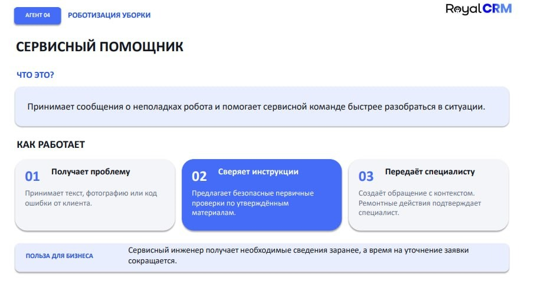

# Бриф к созвону и расширенный концепт: ООО «Чистые решения» (`zrobat.by`)

> [!IMPORTANT]
> **Встреча:** Вторник, 3 ноября 2026 · 15:00 (Минск)  
> **Клиент:** Алексей Лаврукович (Директор ООО «Чистые решения» / бренд **ZROBAT**)  
> **Точка входа (запрос Алексея):** *«Сервисный помощник можно было бы обсудить, начать с него»*

---

## 1. Досье компании: чем занимается ZROBAT и где у них болит

- **Юрлицо:** ООО «Чистые решения» (УНП 193690685, г. Минск, ул. Монтажников, 9).
- **Сайт:** `https://zrobat.by`
- **Профиль:** Официальный импортер и сервисный интегратор коммерческих роботов-уборщиков **Pudu Robotics** в Беларуси.
- **Основные модели в парке:**
  - **Pudu CC1 / CC1 Pro** — коммерческие роботы-пылесосы и поломоечные роботы (4-в-1: подметание, мытье, пылесос, протирка) со станциями автозаправки и слива воды.
  - **Pudu MT1 / MT1 Max** — роботы-подметальщики для крупных складов, паркингов и ТЦ.
  - **Pudu SH1** — вертикальные поломоечные машины, **Pudu T150 / BellaBot** — роботы-доставщики.
- **Бизнес-модель:** Продажа роботов, долгосрочная аренда (робот как услуга), поставка спецхимии и расходников (щетки, резиновые скребки-сквиджи, фильтры), гарантийный и выездной сервис.

### Главная боль сервисной службы ZROBAT сейчас:
1. **Хаос входящих обращений с объектов:** На объектах (в ТЦ, гипермаркетах, бизнес-центрах, складах) с роботами работают обычные клинеры или администраторы смен. Когда робот останавливается, они звонят или пишут в мессенджер: *«Робот встал посреди холла, мигает красным и пищит!»*.
2. **Холостые выезды сервисных инженеров:** В **50–60% случаев** поломки нет — забился сетчатый фильтр грязной воды, залип поплавок бака, намоталась стрейч-пленка на щетку или запачкался оптический датчик лидара. Но диспетчер по телефону не видит экран робота и вынужден отправлять инженера через весь Минск.
3. **Инженер едет «вслепую»:** Когда поломка реальная, инженер до приезда на объект часто не знает ни точного кода ошибки, ни серийного номера робота, ни какую запчасть взять со склада.

---

## 2. Слайд из презентации, который зацепил клиента («Агент 04 — Сервисный помощник»)

---

## 3. Расширенный концепт решения: как мы это реализуем на практике

Мы превращаем идею со слайда в конкретную рабочую систему **«Telegram-ассистент сервисной службы ZROBAT + Битрикс24»**:

### Фишка №0. QR-код на корпусе робота (привязка объекта и серийного номера за 1 секунду)
- На корпус каждого проданного или сданного в аренду робота клеится фирменный стикер с QR-кодом: *«Техподдержка ZROBAT 24/7»* (внутри ссылка вида `t.me/ZrobatServiceBot?start=robot_CC1_8841`).
- Когда клинер или управляющий объектом наводит камеру телефона на QR-код, бот сразу знает:
  - Какая это компания и адрес объекта (например, *БЦ «Титан»*);
  - Какая именно модель робота (`Pudu CC1 Pro`) и его серийный номер;
  - Статус гарантии или договора аренды в **Битрикс24**.

### Шаг 01. Приём проблемы (Фото экрана / Голос / Код ошибки)
- Сотруднику на объекте не нужно искать инструкции. Он просто:
  - **Фотографирует экран робота** с ошибкой (или мигающий индикатор);
  - Либо **наговаривает голосом / пишет текстом**: *«Пишет ошибку слива воды и оставляет лужу»*;
  - Либо отправляет короткое фото узла (например, щетки или скребка).
- ИИ-агент за 5 секунд считывает код ошибки и текст прямо с фотографии экрана.

### Шаг 02. Сверка с базой инструкций Pudu и безопасная самодиагностика (24/7)
- ИИ обращается строго к **утвержденным сервисным регламентам ZROBAT / Pudu** (никаких опасных советов «залезть отверткой в плату»).
- Выдает оператору на экран пошаговую проверку простым языком с картинкой:
  > *«На экране код ошибки водоотведения. Пожалуйста, выполните 2 безопасных шага:*  
  > *1. Откройте верхнюю крышку бака грязной воды и проверьте, не засорился ли сетчатый фильтр.*  
  > *2. Протрите сухой салфеткой датчик уровня (поплавок).*  
  > *Нажмите ниже: [✅ Заработал!] или [❌ Не помогло, нужен инженер]»*.
- **Эффект:** До половины мелких обращений решаются за 2 минуты руками персонала на месте — без звонков диспетчеру и без выезда инженера.

### Шаг 03. Передача сервисному инженеру в Битрикс24 с полным контекстом
- Если первичная проверка не помогла (или ошибка сразу требует вмешательства специалиста — например, сбой мотора привода или лидара):
  - Бот автоматически создает **сервисную заявку (сделку/задачу) в Битрикс24**.
  - В карточке заявки у инженера уже аккуратно собрано:
    1. **Клиент, адрес объекта и контакт человека на месте**;
    2. **Модель робота и серийный номер**;
    3. **Фотография экрана / узла и расшифровка кода ошибки по мануалу**;
    4. **Какие шаги самодиагностики клиент уже проверил**;
    5. **Рекомендация инженеру: какие запчасти/инструмент захватить на выезд**.
- Все ремонтные действия и выезд подтверждает живой специалист сервисной службы.

### Шаг 04 (Дополнительная выгода). Заказ расходников и химии в 2 клика
- В том же боте управляющий объектом может в 1 клик нажать кнопку **«Заказать химию / щетки / сквиджи»** под свою модель робота — и заявка сразу падает менеджеру в Битрикс24.

---

## 4. Сценарий разговора на созвоне и предложение пилота

### Ключевые вопросы Алексею на старте (5 минут):
1. *«Алексей, сколько сейчас примерно роботов на обслуживании/в аренде в полях, и как клиенты обычно сообщают, если робот встал — звонят менеджерам, пишут в Viber/Telegram?»*
2. *«Бывает ли такое, что инженер едет через весь город, а там просто забился фильтр грязной воды, намотался мусор на щетку или датчик протереть надо было?»*
3. *«В каком виде у вас сейчас лежат сервисные мануалы и таблица кодов ошибок по основным моделям (PDF на русском/английском, памятки инженеров)?»*

### Как закрываем на быстрый и понятный пилот:
- **Не раздувать проект на весь каталог сразу:** Предлагаем взять **1–2 самые массовые модели** (например, флагман **Pudu CC1** и **Pudu MT1**).
- Вы даете нам сервисные инструкции и список 20–30 самых частых проблем, с которыми звонят клиенты.
- За **2–3 недели** мы собираем рабочего Telegram-помощника со связкой с вашим **Битрикс24**, тестируем его вместе с вашими сервисными инженерами и запускаем на реальных клиентах.
- **Ориентир бюджета под ключ (MVP):** **3 000 – 4 500 BYN** ($1 000 – $1 400) + **110 – 150 BYN/мес** сопровождение (сервер, токены ИИ на распознавание фото/текста, мониторинг 24/7).
